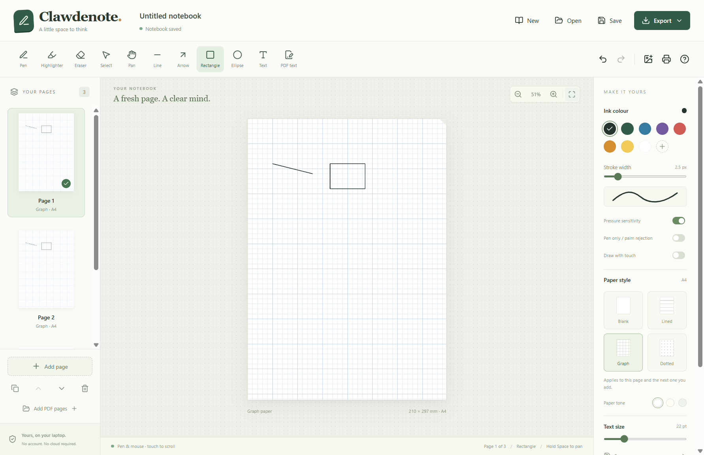

# Clawdenote

A local Windows notebook for handwriting, drawing, and editing PDFs. No account or cloud service is required. Your notebooks, recovery files, and exports stay on your computer.



## Install

Download `Clawdenote-Setup-1.0.2.exe` from the [latest release](https://github.com/Ruibuckets/Clawdenote/releases/latest), run it, and choose an installation folder. Launch Clawdenote from the desktop or Start menu shortcut. The installer is for Windows x64.

The installer is unsigned, so Windows may display an unknown-publisher or SmartScreen prompt.

## Features

- Blank, lined, graph, and dotted A4 paper with white, cream, or pale green tones.
- Pen and highlighter with preset or custom colours, adjustable width, compatible pen pressure, and adjustable ink smoothing.
- A small writing-cursor dot that follows the selected ink colour.
- Whole-annotation eraser, undo/redo, selection and movement, pan, lines, arrows, rectangles, and ellipses.
- Typed notes and local image insertion.
- Add, duplicate, reorder, and delete pages; append PDF pages to a notebook.
- Open PDFs, annotate them, and replace existing horizontal text lines.
- Editable `.clawdenote` notebooks, local recovery, Windows printing, and exports to PDF, PNG, JPEG, or SVG.

Existing `.inkstone` notebooks can still be opened. Use **Save a copy** to save one with the `.clawdenote` extension.

## Everyday use

Choose the paper style in the right panel, then pick a tool, colour, and width. **Add page** inserts a page after the current one. The left panel switches between pages and contains page-management controls.

Start with **Ink smoothing** at **55%** for steadier handwriting. Increase it to soften jitter, or lower it to preserve sharper corners and small letters. **0%** turns smoothing off. To improve an existing stroke, choose **Select & move**, click the stroke, and adjust its smoothing. Undo can restore the previous setting.

**Save** keeps an editable notebook in the folder you choose. Later saves update that file; **Save a copy** chooses another destination. **Export** saves all pages to PDF, or the current page to PNG, JPEG, or SVG. Recovery offers **Restore** on the next launch when a previous working notebook is available.

For existing PDF text, choose **Edit PDF text**, click an outlined line, enter the replacement, and select **Apply replacement**. The old text is removed from the edited page. A duplicated PDF page can be edited independently.

| Action | Shortcut |
| --- | --- |
| Undo / redo | Ctrl+Z / Ctrl+Shift+Z |
| Save / save a copy | Ctrl+S / Ctrl+Shift+S |
| Open / print | Ctrl+O / Ctrl+P |
| Pen / highlighter / eraser | P / H / E |
| Select / text / line | V / T / L |
| Pan temporarily | Hold Space and drag |
| Delete selected annotation | Delete |

## Practical limits

- Physical pen/tablet hardware has not been tested. Pressure and pen-only touch filtering depend on compatible Windows Ink input and your device driver. Mouse drawing and the notebook/PDF workflows have been tested in Electron.
- Scanned PDFs have no selectable text layer; OCR is not included. Rotated or vertical text cannot be replaced. Edit one horizontal line at a time; longer replacements may shrink to fit, and font appearance can change.
- Password-protected PDFs need an unlocked copy. PDF editing restrictions are respected.
- The eraser removes whole annotations. SVG exports embed imported PDF backgrounds as images; PDF exports preserve searchable text. Check exported pages before sharing them.

## Build from source

Use Windows x64 and Node.js 24. From this repository:

```powershell
npm ci
npm run build
npm test
npm run desktop
```

Rebuild after changing the source. `npm run package` builds the Windows installer in `release-clawdenote/` and automatically creates `Clawdenote-Source.zip`.

Run `npm run test:e2e` after building to exercise the Electron workflows. The tests use isolated user data and temporary documents. The [Windows build workflow](.github/workflows/windows-build.yml) installs locked dependencies, builds, runs unit tests, packages the app, and uploads downloadable build artifacts. Releases are published separately.

## License and source

Clawdenote is licensed under **AGPL-3.0-only**. See [LICENSE](LICENSE) and [third-party notices](THIRD_PARTY_NOTICES.txt). Application source is available in this repository and in `Clawdenote-Source.zip`, also included in the installed app's `resources` folder.

The PDF engine is unmodified **MuPDF 1.28.1**, licensed under AGPL-3.0-or-later. Its matching complete source is available as `mupdf-1.28.1-source.tar.gz` with each release, or from the [official source archive](https://mupdf.com/downloads/archive/mupdf-1.28.1-source.tar.gz). The source includes the C engine, JavaScript bindings, dependencies, and build scripts. Follow the [MuPDF 1.28.1 WebAssembly build instructions](https://github.com/ArtifexSoftware/mupdf/blob/1.28.1/platform/wasm/BUILDING.md) to rebuild the engine.
